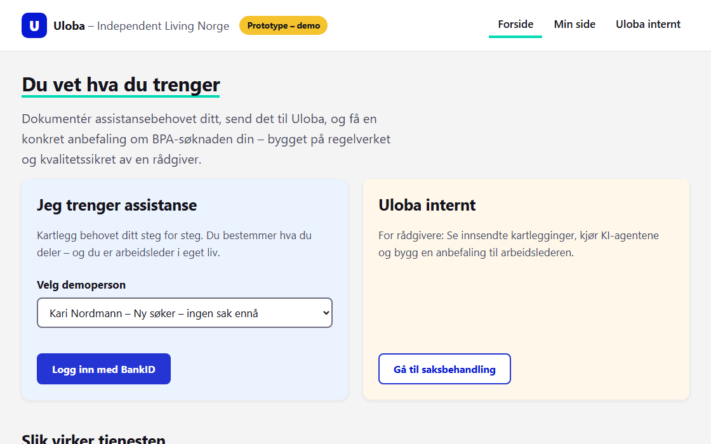

# Uloba BPA-assistent — Proof of Concept

En selvstendig, klikkbar prototype som viser hvordan Uloba kan hjelpe funksjonshemmede med å dokumentere assistansebehovet sitt og få en KI-støttet anbefaling om hva de bør søke kommunen om — med Ulobas rådgiver som obligatorisk kvalitetssikrer.

**Hele flyten i én setning:** Du logger inn med (simulert) BankID, dokumenterer assistansebehovet ditt i en 5-stegs kartlegging, saken sendes til Ulobas interne visning, rådgiveren kjører fire (simulerte) KI-agenter — behovsanalyse, regelverkssjekk, timeberegning og søknadsutkast — og sender en anbefaling tilbake til arbeidslederen med hva hen bør søke om, hvilke krav som gjelder og hvilket regelverk som ligger til grunn.



Se også [docs/arkitektur.md](docs/arkitektur.md) for målarkitekturen i produksjon, [docs/arkitektur-copilot-studio.md](docs/arkitektur-copilot-studio.md) for en variant der KI-agentene kjører i Microsoft Copilot Studio med SharePoint og Power Automate, og [docs/arkitektur-sharepoint-container.md](docs/arkitektur-sharepoint-container.md) for den valgte skissen: portal i Azure Container Apps, saksdata i SharePoint merket Highly Confidential, agenter i Copilot Studio.

## Innhold

| Fil | Rolle |
|---|---|
| `index.html` | Selve applikasjonen (SPA) |
| `css/styles.css` | All styling |
| `js/data.js` | Demodata og regelverkstekster |
| `js/store.js` | Tilstand og lagring (localStorage) |
| `js/app.js` | Visninger, navigasjon og simulerte KI-agenter |

Ingen byggverktøy, ingen avhengigheter, ingen backend. All data lever kun i nettleserens `localStorage`.

## Slik kjører du PoC-en

**Alternativ 1 — åpne direkte:**
Dobbeltklikk på `index.html` (eller dra filen inn i nettleseren). Alt kjører lokalt i nettleseren.

**Alternativ 2 — lokal webserver (anbefalt for presentasjon):**

```bash
npx serve .
```

Åpne deretter adressen som vises (typisk `http://localhost:3000`).

## Demo-manus (ca. 5 minutter)

> Tips før du starter: Nullstill demoen (se nederst) så du starter med blanke ark, og øv gjennom flyten én gang på forhånd.

> **Demoverktøy — generer nye brukere:** På forsiden kan du generere nye demobrukere med ett klikk. «Generer ny bruker» lager en tilfeldig bruker (navn, fødselsår, kommune, bosituasjon) som starter sin egen, ferske søknadsprosess — logg inn med BankID, så er kartleggingen forhåndsutfylt med brukerens opplysninger. «Generer bruker med innsendt kartlegging» lager i tillegg en komplett, realistisk kartlegging som sendes inn automatisk, slik at saken umiddelbart ligger klar i sakslisten hos Uloba med egen saks-ID. Timesummene varierer bevisst mellom båndene under 25, 25–32 og over 32 timer per uke, slik at KI-agentene treffer ulike juridiske vurderinger fra sak til sak. Genererte brukere dukker opp i demoperson-velgeren og kan logge inn som alle andre.

### Del 1 — Arbeidslederen dokumenterer behovet sitt (ca. 2 min)

1. **Åpne appen.** Du lander på forsiden med persona-velger og «Prototype – demo»-badge. Poengter: alt er simulert demoinnhold.
2. **Velg en demoperson** (for eksempel Kari Nordmann — ny søker uten sak) og klikk **«Logg inn med BankID»**.
3. **Klikk deg gjennom de tre simulerte BankID-skjermbildene** — fødselsnummer og engangskode er ferdig utfylt; i passordfeltet skriver du hva som helst. Poengter: i produksjon er dette ekte BankID via ID-porten.
4. **Du er inne på Min side.** Klikk **«Start behovskartlegging»** og gå gjennom de fem stegene. Snakk høyt om hva hvert steg fanger:
   - **Om deg** — personalia og kontaktinformasjon,
   - **Livssituasjon** — bosituasjon, arbeid/studier, familie og fritid,
   - **Assistansebehov** — timer per livsområde, gjerne time for time; summen vurderes fortløpende mot timegrensene i loven,
   - **Dagens tjenester** — hvilke kommunale tjenester som finnes i dag,
   - **Dokumentasjon og samtykke** — oppsummering av alt som sendes, spørsmål om hvem som skal være arbeidsleder (deg selv eller en navngitt annen), dokumenter, fritekst og samtykke.
5. **Send inn kartleggingen.** Du får en kvittering med saks-ID på en egen kvitteringsside — saken er sendt til Uloba.

### Del 2 — Ulobas rådgiver og KI-agentene (ca. 2 min)

6. **Gå til «Uloba internt»** og klikk **«Logg inn som rådgiver (demo)»**. Sakslisten viser den innsendte saken sammen med demosakene.
7. **Åpne saken** og kjør de fire KI-agentene, én etter én. Kommenter hva hver gjør:
   - **Behovsanalyse** — strukturerer beskrivelsen til et samlet behovsbilde og flagger poster som ofte underestimeres.
   - **Regelverkssjekk** — vurderer mot pasient- og brukerrettighetsloven § 2-1 d: under 67 år, behov ut over 2 år, minst 32 timer per uke (eller minst 25 timer per uke, der kommunen har bevisbyrden for merkostnad).
   - **Timeberegning** — foreslår et anbefalt uketimetall per livsområde med begrunnelse.
   - **Søknadsutkast** — genererer et utkast til søknad til kommunen.
8. **Poengter det viktigste:** KI-agentene lager utkast — rådgiveren godkjenner. Mennesket er alltid i løkka, og KI-generert innhold er merket som det.
9. **Klikk «Bygg anbefaling»** og deretter **«Send anbefaling til arbeidslederen»**.

### Del 3 — Arbeidslederen mottar anbefalingen (ca. 1 min)

10. **Bytt tilbake til demopersonen.** Anbefalingen ligger på Min side: hva hen bør søke kommunen om, anbefalt timetall, hvem som ivaretar arbeidslederrollen, hvilke krav som gjelder, og regelverket bak (pbrl. § 2-1 d, hol. §§ 3-2 og 3-8) — pluss påminnelsen om at man søker til kommunen, ikke til Uloba, og at avslag kan påklages innen fire uker.
11. **Avslutt med «Skriv ut / lagre som PDF»** — og målbildet: samme flyt med ekte BankID, ekte Claude-agenter og integrasjon mot Ulobas systemer — se `docs/arkitektur.md`.

### Nullstille demoen

Bruk **«Nullstill demo»**-funksjonen i appen for å slette all lokal data og starte på nytt. Alternativt: tøm nettstedets data i nettleseren (DevTools → Application → Local Storage → slett), eller kjør `localStorage.clear()` i konsollen og last siden på nytt.

## Begrensninger (dette er en PoC)

- **Simulert BankID.** Ingen ekte autentisering — innloggingen er en klikkbar illustrasjon av flyten, med ferdig utfylte skjermbilder.
- **Simulerte KI-agenter.** De fire KI-agentene kjører forhåndsdefinert logikk lokalt i nettleseren. Ingen KI-modell kalles.
- **Ingen backend.** Alt kjører i én HTML-side; «innsending» flytter bare data mellom visninger i samme nettleser.
- **Ingen ekte data.** All informasjon er fiktiv demodata. Ikke legg inn reelle personopplysninger — spesielt ikke helseopplysninger — i PoC-en.
- **Ikke juridisk rådgivning.** Regelverksreferansene er reelle (per august 2026), men PoC-ens vurderinger er illustrasjoner, ikke saksbehandling.

Målarkitektur for en produksjonsversjon — autentisering, ekte agenter, GDPR, universell utforming og veikart — er beskrevet i [`docs/arkitektur.md`](docs/arkitektur.md).
