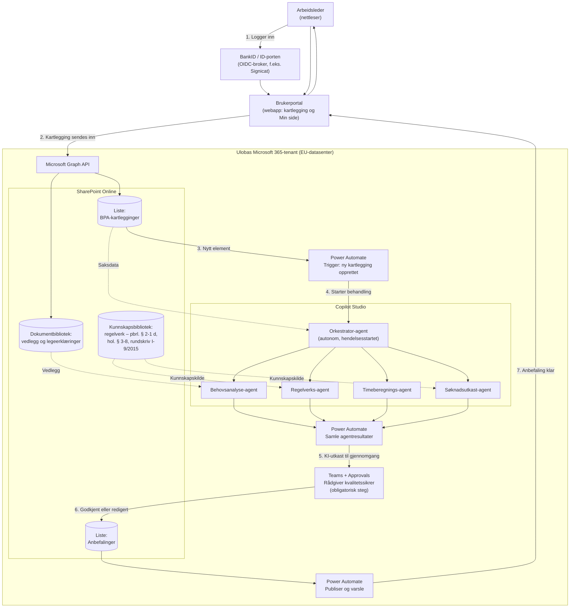

# Målarkitektur: KI-agentene i Microsoft Copilot Studio

Dette er en alternativ realisering av agentlaget beskrevet i [arkitektur.md](arkitektur.md), tilpasset en organisasjon som standardiserer på Microsoft 365 og Power Platform. Prinsippet er det samme som i prototypen: arbeidslederen dokumenterer behovet sitt i portalen, saken behandles av KI-agenter, og en rådgiver kvalitetssikrer alt før anbefalingen går tilbake — men her kjører agentene i **Copilot Studio**, dataene lander i **SharePoint**, og **Power Automate** starter behandlingen automatisk.

## Arkitekturdiagram

## Flyten steg for steg

1. **Innlogging:** Arbeidslederen logger inn i brukerportalen med BankID via ID-porten eller en kommersiell OIDC-broker (eIDAS-nivå betydelig/høyt). Portalen er fortsatt en egen webapp — Copilot Studio erstatter agentlaget, ikke brukerflaten.
2. **Innsending:** Kartleggingen skrives via Microsoft Graph til SharePoint: strukturerte felter (timer per livsområde, livssituasjon, arbeidsleder-valg, samtykke) som element i listen *BPA-kartlegginger*, vedlegg i et eget dokumentbibliotek med unike tilganger per sak.
3. **Automatisk start:** En Power Automate-flyt med trigger «When an item is created» fanger opp den nye kartleggingen.
4. **Agentbehandling:** Flyten starter orkestrator-agenten i Copilot Studio (hendelsesstartet/autonom agent). Den henter saksdata og delegerer til de fire fagagentene:
   - **Behovsanalyse-agenten** strukturerer behovet per livsområde og flagger poster som erfaringsmessig underestimeres.
   - **Regelverks-agenten** vurderer saken mot vilkårene i pbrl. § 2-1 d og hol. § 3-8, *grunnet* («grounded») på kunnskapsbiblioteket med regelverkskilder — ikke på modellens frie kunnskap.
   - **Timeberegnings-agenten** foreslår utmåling per kategori med begrunnelse.
   - **Søknadsutkast-agenten** genererer et redigerbart søknadsbrev til kommunen.
   Hver agent skriver strukturert resultat (JSON/kolonner) tilbake til saken.
5. **Innsamling:** En flyt samler de fire resultatene og bygger utkastet til anbefaling.
6. **Menneskelig kvalitetssikring (obligatorisk):** Rådgiveren får saken i Teams med Approvals. Ingenting sendes ut uten at en rådgiver har godkjent — og alt KI-generert er merket som utkast. Rådgiveren kan redigere fritt før godkjenning.
7. **Tilbake til arbeidslederen:** Den godkjente anbefalingen lagres i *Anbefalinger*-listen, og en flyt varsler arbeidslederen (portal + e-post) om at anbefalingen er klar på Min side.

## Byggeklosser og valg

| Behov | Komponent | Kommentar |
|---|---|---|
| Brukerportal | Egen webapp (som i PoC-en) | Power Pages er et alternativ, men egen app gir full kontroll på universell utforming (WCAG 2.1 AA er lovkrav) |
| Innlogging | ID-porten/BankID via OIDC-broker | Entra External ID støtter custom OIDC-identitetsleverandører |
| Datalagring | SharePoint-lister + dokumentbibliotek | Se personvernavsnittet — vurder Dataverse for selve helseopplysningene |
| Automatisering | Power Automate (premium-lisens) | Triggere, innsamling, varsling |
| KI-agenter | Copilot Studio, autonome/hendelsesstartede agenter | Én orkestrator + fire fagagenter; kunnskapskilder pekes mot regelverksbiblioteket |
| Rådgiver-flate | Teams + Approvals (ev. SharePoint-side) | Human-in-the-loop som eksplisitt, sporbart godkjenningssteg |

## Personvern og sikkerhet (viktigst å avklare tidlig)

- **Helseopplysninger er særlige kategorier (GDPR art. 9).** SharePoint-lister er praktiske, men gir grovkornet tilgangsstyring. Vurder å legge selve helseopplysningene i **Dataverse** (radnivåsikkerhet, feltnivåsikkerhet) og kun metadata/status i SharePoint. DPIA er uansett påkrevd før pilot.
- **Tilgang:** Unike tillatelser per sak, minst mulig stående tilgang, revisjonslogg via Purview. Sensitivitetsetiketter og DLP-regler på både lister og bibliotek.
- **Dataflyt til KI:** Copilot Studio kjører i tenanten med Microsoft 365-databehandleravtalen og EU Data Boundary — men bekreft at agentenes modellkall holder seg innenfor EU/EØS, og dokumentér det i DPIA-en.
- **KI-merking og sporbarhet:** Alle agentutkast merkes som KI-generert, og godkjenningen i Approvals gir sporbarhet på hvem som kvalitetssikret hva, når.

## Forholdet til prototypen

Prototypen i denne mappen simulerer hele denne flyten lokalt i nettleseren: de fire agentkortene i rådgiver-visningen tilsvarer de fire Copilot Studio-agentene, «Send til Uloba» tilsvarer skrivingen til SharePoint, og «Bygg anbefaling»-steget tilsvarer Approvals-godkjenningen. Demoen kan derfor brukes som kravspesifikasjon for Copilot Studio-implementasjonen: samme felter, samme terskellogikk (minst 25/32 timer per uke), samme obligatoriske kvalitetssikring.
