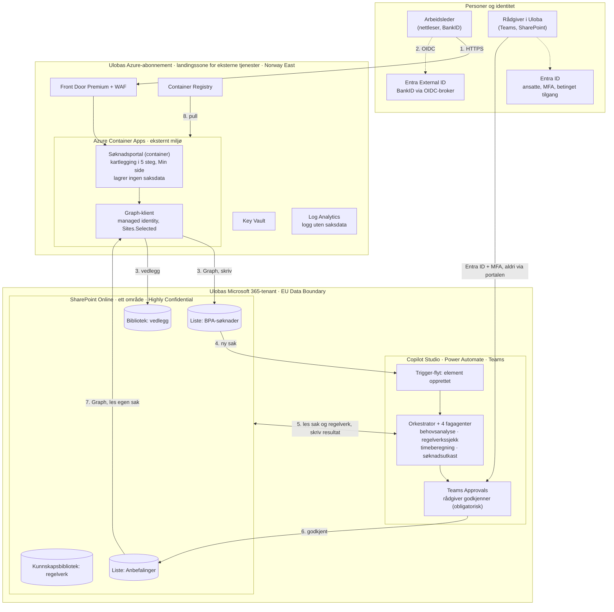

# Arkitekturskisse: ekstern containerapp → SharePoint (Highly Confidential) → KI-agenter

Dette er den varianten av målarkitekturen som ble valgt 22. september 2026: søknadsportalen kjører som én container i **Ulobas eget Azure Container Apps-miljø for eksterne tjenester**, en innsendt kartlegging lander på **ett SharePoint-område merket Highly Confidential** i Ulobas Microsoft 365-tenant, og **Ulobas egne KI-agenter i Copilot Studio** behandler saken der, med rådgiver i løkka.

Det fulle arkitekturdokumentet (11 sider, Atea-stil, med nummerert flyttabell, datatabell, sikkerhetstabell og kjente begrensninger) ligger i `OneDrive - Atea/Documents/Claude/Projects/uloba-bpa-commercial-pack/out/`. Denne siden er kortversjonen for repoet. Se også [arkitektur.md](arkitektur.md) (generell målarkitektur) og [arkitektur-copilot-studio.md](arkitektur-copilot-studio.md) (agentlaget i Copilot Studio).

## Valg som ligger til grunn

| Spørsmål | Valg | Konsekvens |
|---|---|---|
| Hosting av portalen | Azure Container Apps i Ulobas abonnement, landingssone for eksterne tjenester, Norway East | Miljø med workload profiles i eget VNet (gir fast utgående IP og Private Link fra Front Door); portalen lagrer ingen saksdata selv |
| Innlogging for arbeidsledere | Entra External ID med BankID som egendefinert OIDC-identitetsleverandør via broker (Signicat eller Criipto) | Én Microsoft-styrt identitetsflate; portalen får en stabil ekstern bruker-ID som eierfelt på saken; fødselsnummer lagres ikke i portalen |
| Skriving til SharePoint | Microsoft Graph, app-only, managed identity, `Sites.Selected` på ett område | Ingen klienthemmelighet for Graph, ingen tilgang til resten av tenanten; tildelingen gjøres av SharePoint-administrator |
| KI-agenter | Copilot Studio i Power Platform-miljø i Norge-regionen; orkestrator + fire fagagenter, startet av Power Automate-trigger | Ingenting forlater tenanten; nettsøk og «flex routing» må skrus av; agentene eies av en dedikert tjenestekonto |
| Kvalitetssikring | Teams Approvals for rådgiver (Entra ID, MFA, betinget tilgang) | Obligatorisk, sporbart steg før anbefalingen skrives til listen Anbefalinger |

## Diagram

## Dataflyter

| # | Flyt | Protokoll og beskyttelse | Innhold |
|---|---|---|---|
| 1 | Arbeidsleder → portal | HTTPS via Front Door Premium med WAF og ratebegrensning; signert, HTTP-only sesjonscookie | Skjemasteg, vedlegg, kvittering, Min side |
| 2 | Innlogging | OIDC mot Entra External ID → BankID via broker; portalen validerer utsteder, signatur, audience, levetid | Navn, fødselsdato, stabil ekstern bruker-ID |
| 3 | Portal → SharePoint | Graph, app-only, managed identity, `Sites.Selected` (skriv) på ett område | Listeelement + vedlegg, ekstern bruker-ID som eierfelt |
| 4 | Ny sak → agenter | Power Automate-trigger «element opprettet» starter orkestratoren | Saks-ID og hendelse |
| 5 | Agenter ↔ SharePoint | Copilot Studio under en tjenestekonto; området som kunnskapskilde og verktøy | Les sak, vedlegg, regelverk; skriv strukturert resultat per agent |
| 6 | Rådgiver godkjenner | Teams Approvals, Entra ID med MFA; skrives til Anbefalinger | Godkjent/redigert anbefaling, rådgiver, tidspunkt, KI-merking |
| 7 | Anbefaling → arbeidsleder | Graph (les), filtrert på ekstern bruker-ID; e-postvarsel uten innhold | Anbefalingen på Min side |
| 8 | Utrulling | Pipeline med federert identitet → Container Registry → ny revisjon | Container-image tagget per commit |

## Hva som må avklares før noe bygges

- **Etikettpolicyen.** Områdeetiketten Highly Confidential krypterer ikke elementene i seg selv, og det er riktig her: Copilot Studio-agenter kan ikke lese filer som er kryptert av en etikett, selv med Extract-rettighet. Vedleggene må derfor ikke få en krypterende *filetikett*. Krever områdeetiketten en autentiseringskontekst, må Power Automate-flytene testes mot den.
- **Restricted Content Discovery** (SharePoint Advanced Management) må ikke være slått på for området.
- **Agentens identitet.** Hendelsesstartede agenter kjører med eierens identitet; eieren skal være en dedikert tjenestekonto med lesetilgang til området og skrivetilgang til resultatfeltene.
- **EU-grensen.** Nettsøk skrus av for agentene; «flex routing» skrus av (standard på for tenanter opprettet etter 25. mars 2026); bare Microsoft-driftede modeller.
- **Managed identity vs. betinget tilgang.** Betinget tilgang for workload-identiteter dekker ikke managed identities. Krever policy IP-låsing av tokenutstedelse, må portalen bruke app-registrering med sertifikat og Workload Identities Premium i stedet. Anbefalingen er managed identity.
- **Personvern.** Behandlingsgrunnlag for helseopplysninger (art. 9 nr. 2 a eller h) og DPIA (art. 35) før første reelle sak; oppbevaring med Purview-etiketter; sletting av agentresultater etter godkjenning eller anonymisert kvalitetsmåling avgjøres i DPIA-en.
- **Volum.** SharePoint-lister med unike tillatelser per sak skalerer dårlig over noen tusen elementer; Dataverse er alternativet for selve helseopplysningene om volumet blir stort.

## Kostnadsanslag for agentene (forslag, måles i pilot)

Copilot Studio måles i Copilot Credits: agenthandling/trigger 5, generativt svar 2, innholdsbehandling 8 per side (Microsoft Learn, september 2026). En sak med orkestrator, fire fagagenter og noen sider vedlegg er grovt 40 til 120 credits, altså under 1,5 USD ved 0,01 USD per credit; tenantpakken er 25 000 credits for 200 USD per måned (Microsofts prisside, 22. september 2026).

## Kilder (Microsoft Learn, lest 22. september 2026)

- [Selected permissions for SharePoint sites, lists and files](https://learn.microsoft.com/en-us/graph/permissions-selected-overview)
- [Assign a managed identity access to an application role](https://learn.microsoft.com/en-us/entra/identity/managed-identities-azure-resources/assign-app-role-managed-identity-powershell)
- [Custom OIDC federation in Entra External ID](https://learn.microsoft.com/en-us/entra/external-id/customers/how-to-custom-oidc-federation-customers)
- [Sensitivity labels for Teams, groups and sites](https://learn.microsoft.com/en-us/purview/sensitivity-labels-teams-groups-sites)
- [Copilot Studio and Purview](https://learn.microsoft.com/en-us/purview/ai-copilot-studio) · [SharePoint as knowledge](https://learn.microsoft.com/en-us/microsoft-copilot-studio/knowledge-add-sharepoint) · [Triggers](https://learn.microsoft.com/en-us/microsoft-copilot-studio/authoring-triggers-about) · [Data location](https://learn.microsoft.com/en-us/microsoft-copilot-studio/data-location) · [Billing and licensing](https://learn.microsoft.com/en-us/microsoft-copilot-studio/billing-licensing)
- [Restricted Content Discovery](https://learn.microsoft.com/en-us/sharepoint/restricted-content-discovery)
- [Conditional Access for workload identities](https://learn.microsoft.com/en-us/entra/identity/conditional-access/workload-identity)
- [Container Apps: custom VNet](https://learn.microsoft.com/en-us/azure/container-apps/custom-virtual-networks) · [Front Door Private Link](https://learn.microsoft.com/en-us/azure/container-apps/front-door-custom-virtual-network-private-link)
- [Pasient- og brukerrettighetsloven § 2-1 d](https://lovdata.no/dokument/NL/lov/1999-07-02-63/KAPITTEL_2#%C2%A72-1d)
