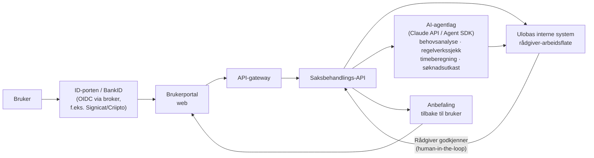

# Målarkitektur — Uloba BPA-assistent i produksjon

Dette dokumentet beskriver hvordan PoC-en (se `../README.md`) realiseres som produksjonstjeneste: ekte innlogging, ekte AI-agenter med rådgiver i løkka, og forsvarlig håndtering av helseopplysninger.

## 1. Oversikt

Prinsippet er uendret fra PoC-en: brukeren dokumenterer behovet, agentene lager utkast, rådgiveren godkjenner, brukeren får en begrunnet anbefaling. Alt mellom portal og interne systemer går gjennom API-gatewayen (autentisering, autorisasjon, rate limiting, logging).

## 2. Autentisering

- **Ekte BankID via ID-porten** (Digdir) eller en kommersiell OIDC-broker som **Signicat** eller **Criipto**. En broker gir én OIDC-integrasjon mot BankID, BankID på mobil og ev. andre eID-er, uten at Uloba selv må være BankID-brukersted. ID-porten er aktuelt dersom tjenesten regnes som offentlig-tilknyttet; broker er ofte raskest for en privat/ideell aktør.
- **Sikkerhetsnivå:** Tjenesten behandler helseopplysninger, så innlogging bør kreve **eIDAS-nivå høyt** (BankID kvalifiserer). *Substantial* kan vurderes for rene informasjonssider, men all innsyn i egen sak krever høyt nivå.
- **Sesjonshåndtering:** Kortlevde tokens (OIDC access/ID-token), sesjon på server-side eller signerte, httpOnly-cookies; inaktivitets-timeout (f.eks. 15–30 min) med re-autentisering for sensitive handlinger; sikker utlogging som terminerer sesjonen både lokalt og hos identitetsleverandøren (RP-initiated logout).
- **Rådgivere** logger inn via Ulobas egen IdP (f.eks. Entra ID) med MFA og rollestyrt tilgang (RBAC) — rådgiver ser kun saker hen er tildelt.

## 3. AI-agentene i produksjon

De fire agentene fra PoC-en realiseres med **Claude-modeller** via Claude API / Agent SDK, orkestrert i saksbehandlings-API-et (aldri direkte fra nettleseren):

| Agent | Realisering |
|---|---|
| **Behovsanalyse** | Claude med **structured output** (JSON-skjema): strukturerer kartleggingen til behovskategorier, omfang og mål. Ingen fri tekst inn i saksflyten uten skjema-validering. |
| **Regelverkssjekk** | Claude med **verktøybruk (tool use)** mot kuraterte regelverkskilder: pbrl. § 2-1 d, hol. §§ 3-2/3-8, rundskriv I-9/2015 og I-4/2024 (Lovdata/Helsedirektoratet). Agenten siterer alltid kilde og paragraf, og vurderer vilkårene: under 67 år, behov ut over 2 år, ≥ 32 t/uke — samt 25–32-timersbåndet der kommunen har bevisbyrden. |
| **Timeberegning** | Claude med structured output pluss deterministisk etterberegning i kode: modellen kategoriserer og foreslår, summering og validering skjer i vanlig programlogikk. |
| **Søknadsutkast** | Claude genererer utkast til søknad til kommunen basert på de tre foregående agentenes strukturerte resultat og Ulobas sjekkliste for en sterk BPA-søknad. |

**Ufravikelige prinsipper:**

- **Human-in-the-loop er et obligatorisk steg.** Ingen anbefaling eller søknadsutkast når brukeren uten at en rådgiver eksplisitt har gjennomgått, ev. redigert, og godkjent innholdet. Agentene har ingen selvstendig beslutningsmyndighet — dette holder løsningen utenfor forbudet mot helautomatiserte avgjørelser (GDPR art. 22) og er riktig faglig og etisk.
- **KI-utkast merkes alltid** som KI-generert, både i rådgiverflaten og i det brukeren mottar, med navn på rådgiveren som har kvalitetssikret.
- **Sporbarhet:** Alle agentkjøringer logges (modellversjon, prompt-versjon, kilder brukt, rådgivers endringer) slik at enhver anbefaling kan etterprøves.
- **Regelverkskildene versjoneres** og oppdateres redaksjonelt (BPA-regelverket er i bevegelse — ekspertutvalget leverer innen 15. desember 2026), slik at agentene aldri resonnerer på utdatert jus.

## 4. Datahåndtering og GDPR

- **Særlige kategorier:** Kartleggingen inneholder helseopplysninger — **GDPR art. 9**. Behandling krever både grunnlag etter art. 6 og unntak etter art. 9, i praksis **uttrykkelig samtykke (art. 9 nr. 2 a)** innhentet i portalen, alternativt art. 9 nr. 2 h der Ulobas rolle tilsier det. Endelig valg forankres i personvernrådgivning før pilot.
- **DPIA er påkrevd** (art. 35): systematisk behandling av helseopplysninger om en sårbar gruppe med ny teknologi (KI) treffer flere av kriteriene for høy risiko. DPIA gjennomføres før pilot og oppdateres per fase; forhåndsdrøfting med Datatilsynet ved restrisiko.
- **Dataminimering:** Kartleggingen spør bare om det som trengs for BPA-vurderingen. Agentene får kun saksrelevante felter — ikke hele brukerprofilen. Fritekstfelter begrenses og veiledes.
- **EU/EØS-databehandling:** All lagring og prosessering i EU/EØS, inkludert KI-kall — Claude API brukes med **dataresidens/prosessering i EU** og uten at innhold brukes til modelltrening. **Databehandleravtaler (art. 28)** inngås med alle leverandører, **også KI-leverandøren** (Anthropic eller skyleverandør som tilbyr Claude, f.eks. Vertex AI/Bedrock i EU-region), med underdatabehandlere kartlagt.
- **Sletterutiner:** Definerte lagringstider per dataklasse (utkast, innsendt kartlegging, anbefaling, logger); automatisk sletting når formålet er oppfylt; sletting av agent-mellomresultater umiddelbart etter godkjent anbefaling. Ingen persistering av persondata hos KI-leverandør (zero data retention der det tilbys).
- **Brukerens rettigheter:** Innsyn i egne data direkte i portalen (art. 15), dataportabilitet (eksport av egen kartlegging og anbefaling), retting, sletting og trukket samtykke som faktisk stopper behandlingen.

## 5. Universell utforming

Løsningen retter seg mot funksjonshemmede — universell utforming er både lovpålagt og selve poenget:

- **Rettslig krav:** Likestillings- og diskrimineringsloven §§ 17–18 med forskrift om universell utforming av IKT krever minst **WCAG 2.1 nivå AA** for nettløsninger (tilsyn: Digdir/Uu-tilsynet).
- **I praksis:** Full tastaturnavigasjon; korrekt semantikk og ARIA for skjermlesere (kartleggingen som skjema med tydelige steg, ledetekster og feilmeldinger); kontrastkrav; synlig fokus; ingen tidsavbrudd uten forvarsel og forlengelse; forståelig språk (klarspråk); mulighet for å lagre og fortsette senere; støtte for 400 % zoom og reflow.
- **Prosess:** Tilgjengelighet inn i definition of done, automatiske sjekker (axe) i CI, manuell testing med skjermleser, og **brukertesting med Ulobas egne medlemmer** i hver fase. Tilgjengelighetserklæring publiseres.

## 6. Integrasjoner

- **Ulobas interne systemer:** Saksbehandlings-API-et publiserer **hendelser** (sak innsendt, agentkjøring fullført, anbefaling godkjent/sendt) på en meldingsbuss; interne systemer (CRM/medlemssystem, arkiv) abonnerer. Synkron lesing skjer via REST/GraphQL bak gatewayen. Hendelsesbasert kobling gjør at portalen ikke er hardt avhengig av interne systemers oppetid.
- **Fremtidig:** Mulig integrasjon mot **kommunale fagsystemer** (innsending av ferdig søknad til riktig kommune) og **Altinn/eFormidling** som formell forsendelseskanal, samt digital fullmakt der noen søker på vegne av brukeren. Dette krever avtaler per kommune/leverandør og legges etter produksjonssetting av kjerneflyten. Merk: vedtaket fattes alltid av kommunen — løsningen forbereder og kvalitetssikrer søknaden, den erstatter aldri kommunens saksbehandling.

## 7. Veikart i tre faser

| | Fase 1: PoC (denne) | Fase 2: Pilot | Fase 3: Produksjon |
|---|---|---|---|
| **Innlogging** | Simulert BankID | Ekte BankID via broker (test- og prod-miljø), eIDAS høyt | Herdet, med overvåking og hendelsesrespons |
| **Agenter** | Simulert lokalt i nettleser | Ekte Claude-agenter med structured output og regelverkskilder; rådgivergodkjenning obligatorisk | Versjonert prompt-/kilderegime, evaluering og kvalitetsmåling av agentresultater |
| **Data** | Kun localStorage, fiktive data | Ekte data for **begrenset brukergruppe** (inviterte medlemmer), DPIA og databehandleravtaler på plass før første bruker | Fullskala med sletterutiner, innsynsportal og revisjonslogg |
| **UU** | Grunnleggende | WCAG 2.1 AA-revisjon + brukertesting med medlemmer | Tilgjengelighetserklæring, kontinuerlig testing i CI |
| **Integrasjon** | Ingen (samme app) | Lesekobling mot internt system | Full hendelsesbasert integrasjon; kommunale kanaler/Altinn utredes |
| **Mål** | Vise flyten og skape forankring | Validere nytteverdi, treffsikkerhet og forsvarlighet med ekte saker | Tilby tjenesten til alle Ulobas medlemmer |

**Exit-kriterier fase 2 → 3:** dokumentert treffsikkerhet i regelverkssjekk og timeberegning mot rådgivers fasit, ingen alvorlige personvernavvik, UU-revisjon bestått, og positiv evaluering fra pilotbrukerne selv — i tråd med Independent Living-prinsippet om at løsninger for funksjonshemmede skal styres av funksjonshemmede.
